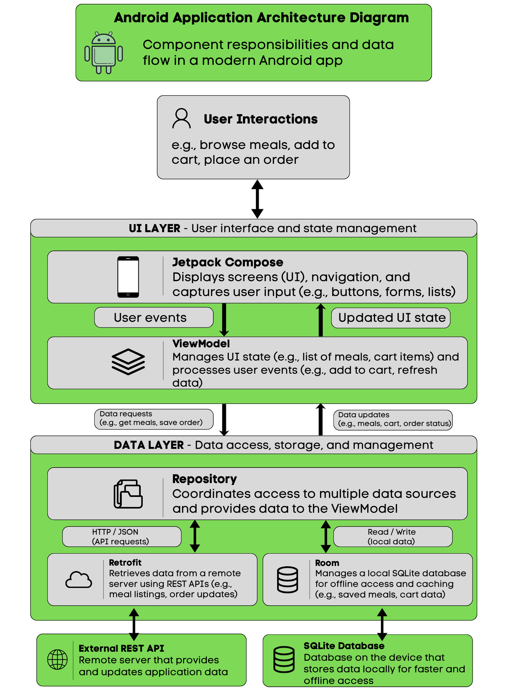

# Mobile App Developer Career Preparation Plan

*© Image from Brain Technosys, “Considerations to Make When Choosing a Mobile Application Development Company.”*

**Prepared for:** Husky student pursuing a job as a mobile app developer

**Prepared by:** Mustafa Emir Okten

**Date:** November 26, 2026

## Table of Contents

- [Purpose](#purpose)
- [Developing Mobile App Fundamentals](#developing-mobile-app-fundamentals)
- [Applying Mobile Development Practices](#applying-mobile-development-practices)
- [Developing a Professional Portfolio](#developing-a-professional-portfolio)
- [Gaining Professional Experience](#gaining-professional-experience)
- [Preparing for Mobile Development Careers](#preparing-for-mobile-development-careers)
- [References](#references)

## Purpose

Although your CSSE coursework at UW Bothell provides a strong foundation in software development, preparing for a career as a mobile app developer requires additional experience with platform-specific development tools, application architecture, and mobile user interface design. The purpose of this report is to outline the best practices you can follow before graduation to prepare for a career as a mobile app developer.

## Developing Mobile App Fundamentals

### Learning Android Development Tools

Focusing on one mobile platform first allows you to develop a stronger understanding of mobile development. Employers value practical experience with platform-specific tools because it demonstrates your ability to develop applications beyond general programming assignments.

Begin with Android development using Kotlin and Android Studio. Follow Google's Android development tutorials to practice creating screens, handling user input, and navigating between screens [^1].

### Developing User Interface Design Skills

Mobile applications depend on clear layouts and usable interactions. Employers value developers who can build applications that are both functional and easy to navigate.

Use Jetpack Compose to create consistent layouts, interactive components, and navigation between screens. Incorporate interface design throughout the development process rather than after the application is functional.

## Applying Mobile Development Practices

### Implementing Application Architecture

Separating user interface code from data management makes mobile applications easier to test and maintain [^2]. Employers value this practice because professional applications require ongoing maintenance and feature development without disrupting existing functionality.

Organize your Android application into a UI layer and a data layer. Follow the architecture illustrated in Figure 1 to structure your application components and manage the flow of 
data between them.

**Figure 1. Android Application Architecture and Data Flow**

### Testing and Debugging Applications

Identifying problems early makes them easier to isolate and fix before applications become more complex. Employers value developers who can deliver reliable applications and prevent existing features from breaking.

Test each feature as you build it. Use the Android Studio emulator to verify user interactions and Logcat to identify errors. Test unsuccessful API requests and invalid user input alongside successful interactions.

## Developing a Professional Portfolio

### Building Mobile Applications

Gürkan Atay, a staff software engineer at OfferUp, recommends developing a complete application that solves a real problem and goes beyond an initial working demo [^3]. Completed applications demonstrate your ability to apply technical knowledge independently.

Build a task management application using Kotlin and Jetpack Compose. After completing it, develop a recipe application that retrieves recipes from a REST API and stores saved recipes locally. Test the application and gather feedback from users.

### Documenting Development Projects

Well-documented projects allow employers to evaluate your technical abilities, development decisions, and contributions without examining the entire codebase.

Publish both applications to GitHub. Include README files containing each application's purpose, technologies, major features, architecture, setup instructions, and screenshots.

## Gaining Professional Experience

### Pursuing Mobile Development Internships

Atay emphasizes that internships provide experience with professional development teams, existing codebases, requirements management, and software testing [^3]. Employers value this experience because it demonstrates your ability to contribute to an established development team.

Search Handshake for Android development internships. Prioritize positions involving Kotlin, Android Studio, and mobile application development. Include your completed Android projects when applying.

### Building Professional Connections

Employers value developers who communicate technical decisions clearly, collaborate with teammates, and respond constructively to feedback [^3].

Participate in university hackathons and contribute to a shared GitHub repository using branches, pull requests, and code reviews. Connect with participating developers to maintain professional relationships beyond the event.

## Preparing for Mobile Development Careers

### Tailoring Job Applications

Connecting your project experience to specific job requirements helps employers recognize how your skills align with the position.

Identify Android developer positions that require Kotlin, Jetpack Compose, and REST API integration. Highlight relevant features from your completed applications in your resume and include links to their GitHub repositories.

### Preparing for Technical Interviews

Atay explains that entry-level candidates stand out when they can demonstrate completed projects, explain their technical decisions, and discuss how they tested their applications [^3].

Practice demonstrating your completed Android applications. Explain how data moves between the UI and data layers, how your application handles unsuccessful API requests, and what improvements you would make to its architecture.

[word count: 671]

## References

[^1]: Google, "Kotlin for Android," *Android Developers*, n.d. [Online]. Available: https://developer.android.com/kotlin. [Accessed Oct. 27, 2026].

[^2]: Google, "Guide to app architecture," *Android Developers*, 5 October 2026. [Online]. Available: https://developer.android.com/topic/architecture. [Accessed Oct. 27, 2026].

[^3]: Atay, Gürkan. Personal interview. 17 November 2026.
