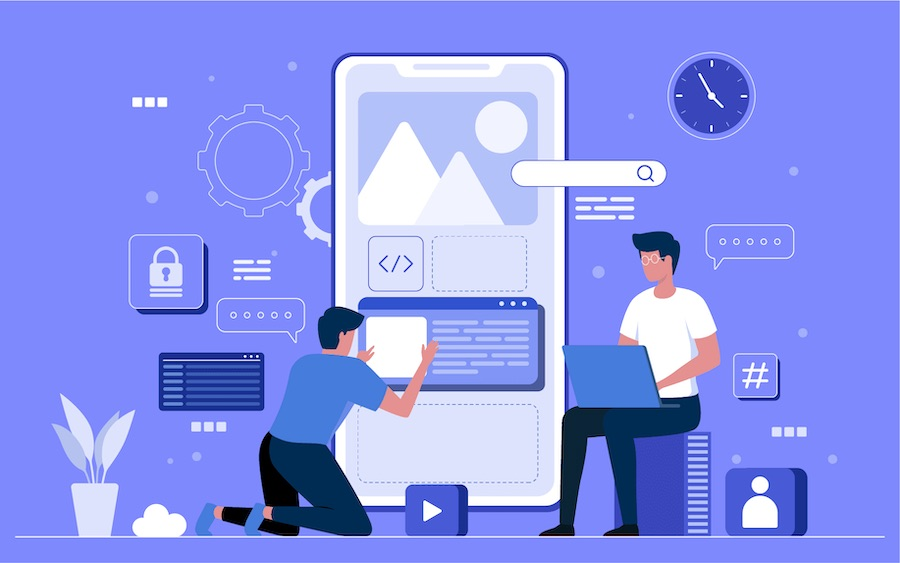
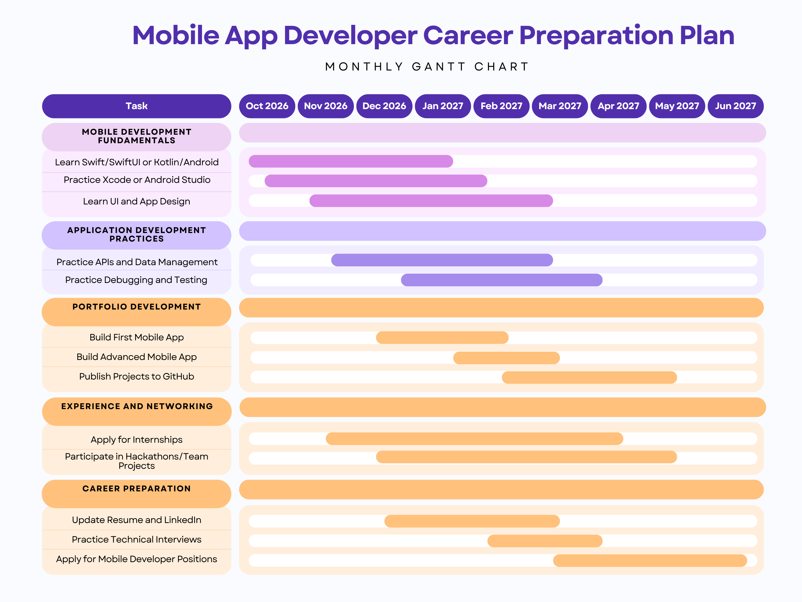

# Mobile App Developer Career Preparation Plan

*© Image from Brain Technosys, “Considerations to Make When Choosing a Mobile Application Development Company.”*

Prepared for: Husky student pursuing a job as a mobile app developer

Prepared by: Mustafa Emir Okten

Date: November 5, 2026

## Table of Contents

- [Purpose](#purpose)
- [Mobile Development Fundamentals](#mobile-development-fundamentals)
- [Application Development Practices](#application-development-practices)
- [Portfolio Development](#portfolio-development)
- [Experience and Networking](#experience-and-networking)
- [Career Preparation](#career-preparation)
- [Preparation Timeline](#preparation-timeline)
- [References](#references)

## Purpose

This report outlines the best practices you can follow before graduation to prepare for a career as a mobile app developer. Although a computer science degree provides a strong foundation, academic coursework alone may not provide all the skills and experience needed to enter the field. To bridge this gap, the report explores Mobile Development Fundamentals, Application Development Practices, Portfolio Development, Experience and Networking, and Career Preparation. A Preparation Timeline illustrates how these activities can be organized throughout your remaining time at UW Bothell. Following these practices helps you apply your CSSE coursework to real-world development, demonstrate your abilities to potential employers, and build the qualifications needed to pursue a career in mobile app development.

## Mobile Development Fundamentals

Start by choosing a mobile platform and developing experience with its primary tools. For iOS development, focus on Swift, SwiftUI, and Xcode. Apple's Develop in Swift tutorials introduce developers to Swift, SwiftUI, Xcode, app design, data modeling, testing, and debugging [1]. For Android development, focus on Kotlin and Android Studio. Google's Android Developers documentation identifies Kotlin as a programming language used for Android development and provides resources for developing Android applications with Kotlin [2]. Focusing on one platform first allows you to develop a stronger understanding of mobile development before expanding into another platform.

Develop user interface and app design skills alongside programming. Mobile applications depend on clear layouts and usable interactions, so practice turning simple ideas into interfaces that are consistent and easy to navigate. Treat design as part of the development process rather than something that is added after an application is functional.

## Application Development Practices

Develop the skills needed to turn individual screens and features into complete applications. Learn how to work with APIs, manage and store data, and process user input. Become familiar with how mobile applications are organized. Google's Android architecture guidance recommends separation of concerns, which involves organizing code according to its responsibilities. For example, separating user interface code from data management makes applications easier to test and maintain [3].

Make testing and debugging part of your normal development process. Instead of waiting until an application is complete, test features as you build them. Identifying problems early makes them easier to isolate and fix before your applications become more complex.

## Portfolio Development

Begin by building a smaller mobile application that allows you to practice the fundamentals of your chosen platform. After completing that project, create a more advanced application that demonstrates additional skills. The second application could include features such as API integration, persistent data, or a more complex user interface.

Publish your strongest projects to GitHub and include clear README files that explain each application's purpose, technologies, major features, and setup process. A portfolio provides examples of what you can actually build instead of relying only on a list of programming languages or completed coursework.

## Experience and Networking

Apply for internships while continuing to develop your technical skills and portfolio. You should also participate in hackathons or team projects where you can practice collaboration, version control, problem solving, and communication. These experiences provide opportunities to apply technical knowledge while working with other developers.

Use these opportunities to meet other developers and learn how teams divide responsibilities and respond to feedback. Software development frequently requires collaboration, so being able to communicate technical decisions and contribute to a shared project can strengthen your preparation for professional development work.

## Career Preparation

Update your resume and LinkedIn profile as you complete projects and gain experience instead of waiting until graduation. Emphasize relevant mobile development skills and completed projects that demonstrate what you can contribute.

Begin practicing technical interviews before your main application period. Review programming fundamentals, data structures, algorithms, debugging, and common software development questions. As graduation approaches, begin applying for mobile developer positions and related software engineering roles while continuing to improve your portfolio.

## Preparation Timeline

The Gantt chart below organizes the recommended activities from October 2026 through June 2027. Mobile Development Fundamentals begins first, followed by Application Development Practices and Portfolio Development. Experience and Networking overlaps with these activities, while Career Preparation gradually shifts toward technical interviews and job applications as graduation approaches. The overlapping schedule allows you to develop skills, gain experience, and prepare for employment alongside your coursework.

**Figure 1. Mobile App Developer Career Preparation Timeline**

## References

[1] Apple, "Develop in Swift Tutorials," *Apple Developer Documentation*. [Online]. Available: https://developer.apple.com/tutorials/develop-in-swift. [Accessed: Oct. 27, 2026].

[2] Google, "Kotlin for Android," *Android Developers*. [Online]. Available: https://developer.android.com/kotlin. [Accessed: Oct. 27, 2026].

[3] Google, "Guide to app architecture," *Android Developers*. [Online]. Available: https://developer.android.com/topic/architecture. [Accessed: Oct. 27, 2026].

[word count: 688]
